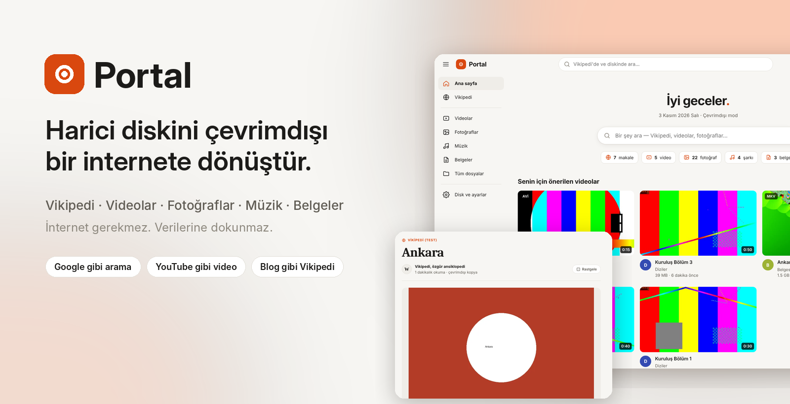
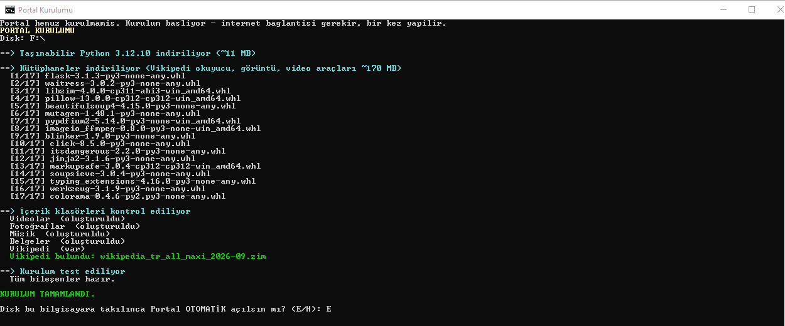
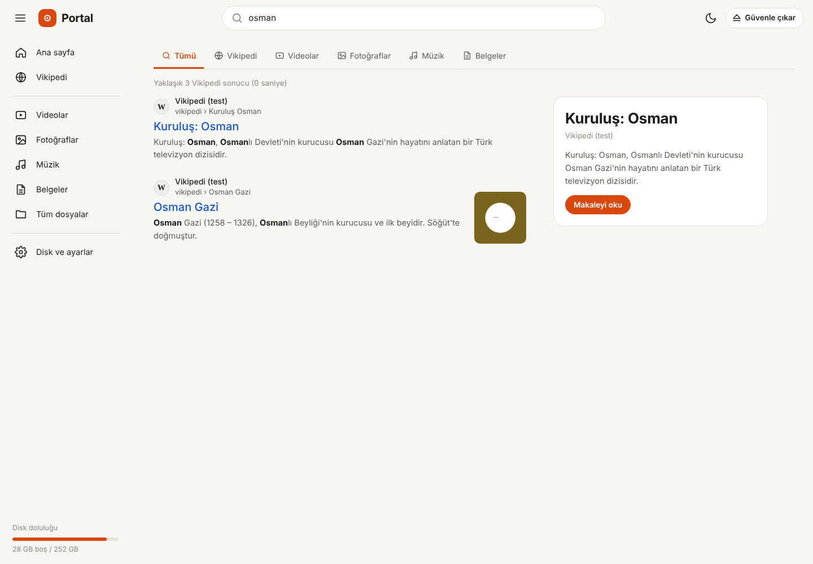
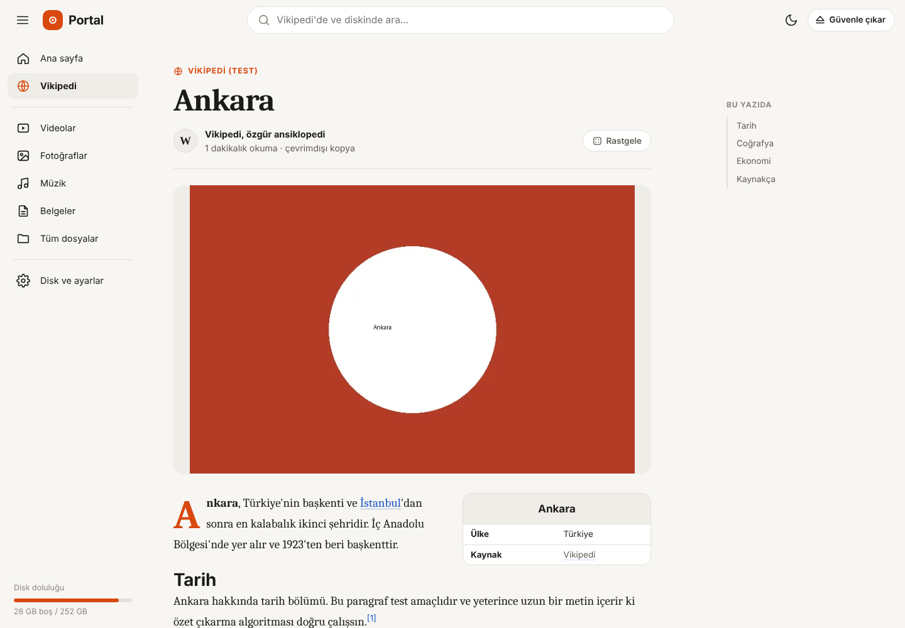
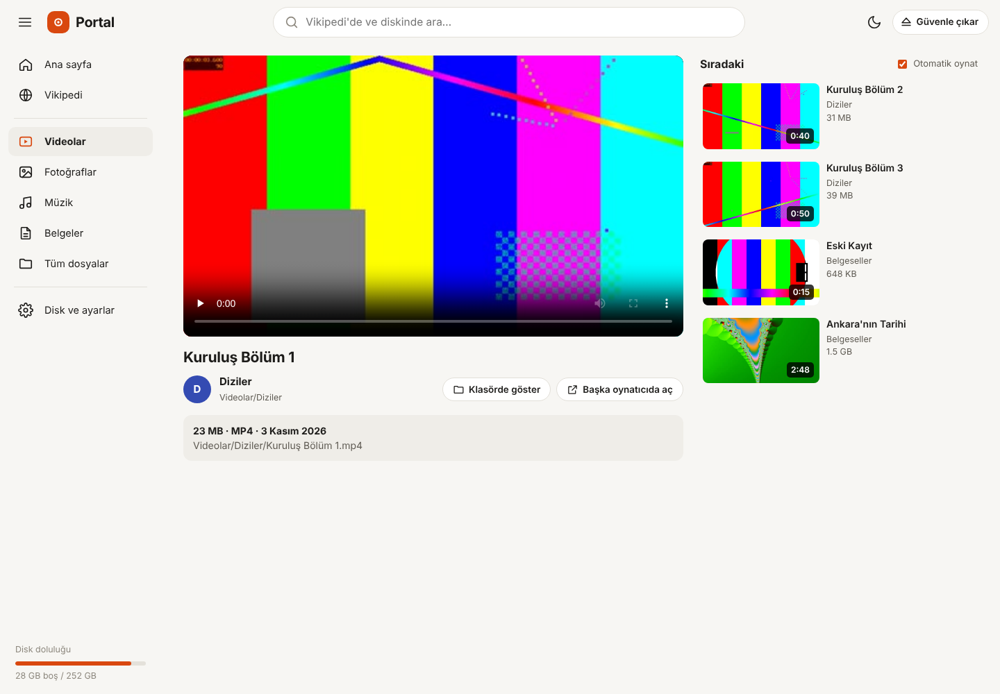
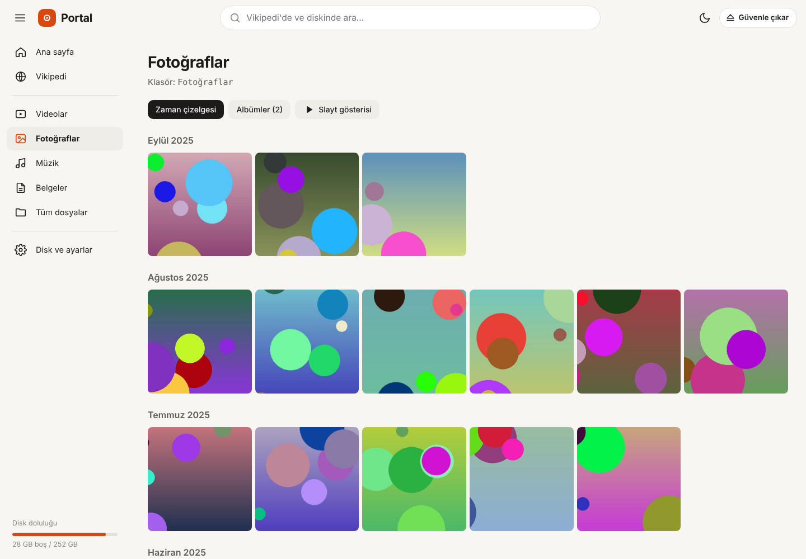
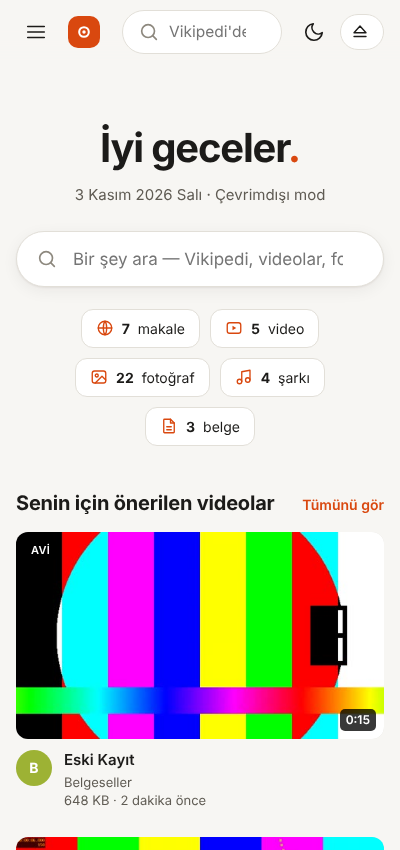

<p align="center">
  
</p>

<h1 align="center">Portal</h1>

<p align="center">
  <b>Harici diskini, internete bağlıymışsın gibi gezebileceğin çevrimdışı bir siteye dönüştür.</b><br>
  Vikipedi'de Google gibi ara, videolarını YouTube gibi izle, fotoğraflarını albümlerde gez.
</p>

<p align="center">
  
  
  
  
</p>

<p align="center">
  <a href="#-hızlı-başlangıç">Hızlı başlangıç</a> ·
  <a href="#-özellikler">Özellikler</a> ·
  <a href="#-ekran-görüntüleri">Ekran görüntüleri</a> ·
  <a href="#-verilerim-güvende-mi">Güvenlik</a> ·
  <a href="#-english">English</a>
</p>

---

## Nedir?

Elinde [Kiwix](https://kiwix.org) formatında bir Vikipedi dosyası (`.zim`) ve harici bir disk dolusu video, fotoğraf, müzik, belge var. Portal bunların hepsini **tek bir tarayıcı arayüzünde** toplar:

- Diski takarsın, tarayıcıda **kendi "internetin"** açılır.
- Üstteki arama kutusuna yazdığında Vikipedi'den **web arama sonuçları gibi** makaleler, diskinden de eşleşen videolar/fotoğraflar gelir.
- Makaleler **blog yazısı** düzeninde okunur; videolar **YouTube** gibi önerilerle oynar.

Hepsi diskin içinde çalışır. İnternet gerekmez, bilgisayara program kurulmaz.

## 🚀 Hızlı başlangıç

> Kurulum **bir kez**, internet varken yapılır. Sonra disk her Windows bilgisayarda internetsiz çalışır.

**1. İndir ve diskinin köküne kopyala**

[Bu depoyu ZIP olarak indir](https://github.com/Akkbas/portal/archive/refs/heads/main.zip), açtığın klasörün **içindekileri** harici diskinin köküne kopyala:

```
E:\
├── Portali Ac.bat          ← çift tıkla, Portal açılsın
├── BENIOKU.txt
├── Portal\                 ← program (dokunmana gerek yok)
├── Vikipedi\               ← wikipedia_tr_all_maxi_….zim buraya
├── ZARA DOĞUM\             ← kendi klasörlerin olduğu gibi kalır;
├── KÖY BAYRAMLAR\             Portal hepsini tarar ve türüne göre ayırır
└── …
```

**2. Vikipedi dosyasını edin** *(isteğe bağlı)*

[Kiwix kütüphanesinden](https://library.kiwix.org/) istediğin dilde Vikipedi'yi indir (ör. `wikipedia_tr_all_maxi`) ve `Vikipedi\` klasörüne koy. Resimli tam sürüm için **maxi**, daha küçük boyut için **nopic** seç.

**3. Kur**

`Portal\Kurulum.bat` dosyasına çift tıkla. Taşınabilir Python'u ve kütüphaneleri **diskin içine** indirir (~180 MB). Sonunda *"Disk takılınca otomatik açılsın mı?"* diye sorar.

<p align="center"><br><sub>Kurulum birkaç dakika sürer. Vikipedi dosyasını bulur, eksik klasörleri oluşturur, bileşenleri test eder.</sub></p>

**4. Kullan**

- Otomatik açılmayı kurduysan: **diski tak → Portal açılır.**
- Başka bir bilgisayarda: diskteki `Portali Ac.bat` dosyasına çift tıkla.
- Adres: <http://localhost:8765>

## ✨ Özellikler

| | |
|---|---|
| 📁 **Klasörlerim** | Diskin tamamı taranır; dosyaların hangi klasörde olursa olsun bulunur. Ana sayfada klasörlerin kapak resimleriyle listelenir; bir klasöre girince içindeki videolar, fotoğraflar, müzikler ve belgeler bir arada açılır. |
| 🔎 **Birleşik arama** | Vikipedi'de tam metin arama + diskindeki dosyalarda arama. Google benzeri sonuç sayfası, bilgi paneli, sayfalama ve yazarken öneriler. Türkçe karakter duyarsız: `kurulus` yazınca `Kuruluş` bulunur. |
| 📖 **Blog gibi Vikipedi** | Makaleler okunaklı bir dergi düzeninde: kapak görseli, içindekiler, bilgi kutusu, "ilgili okumalar". Günlük keşfet kartları ve rastgele makale. |
| 🎬 **YouTube gibi videolar** | Önerilen videolar, kaldığın yerden devam, otomatik sıradaki video, klasör "kanalları", `.srt` altyazı. MKV / AVI / WMV anlık dönüştürülerek oynatılır. |
| 🖼️ **Fotoğraflar** | Çekim tarihine göre zaman çizelgesi, klasör albümleri, tam ekran görüntüleyici ve slayt gösterisi. |
| 🎵 **Müzik** | Albüm kapakları ve etiketlerle liste; sayfalar arasında çalmaya devam eden alt çalar, karışık çalma. |
| 📄 **Belgeler** | PDF önizleme kapakları; PDF ve metin dosyaları tarayıcıda açılır, Word/Excel bilgisayardaki programla. |
| 🏷️ **Etiketler** | Videolara ve fotoğraflara kendi etiketlerini ekle (ör. *Zara*, *Doğum günü*); birden fazla etiket seçilebilir. Aramada etiket adını yazınca o dosyalar gelir. Etiket sayfasında birkaç etiketle birlikte filtrele; etiketleri yeniden adlandır ya da sil. |
| ✏️ **Ad ver, sil** | Video, fotoğraf, şarkı ve belgelerin adını kalem simgesiyle ya da çift tıklayarak değiştir; aramada bu adla bulursun (dosya adı değişmez). Çöp kutusu simgesiyle sil; çöp kutusundan geri al. |
| 🗂️ **Tüm dosyalar** | Diskin tamamı için salt okunur dosya gezgini. |
| 🔌 **Tak-çalıştır** | Disk takılınca otomatik açılır. "Güvenle çıkar" düğmesiyle kapanır. |
| 🌗 **Açık / koyu tema** | Sistem temasını izler, tek tıkla değişir. Telefon ve tablet ekranlarına uyumlu. |

## 📸 Ekran görüntüleri

<table>
  <tr>
    <td><p align="center"><b>Arama</b> — Vikipedi sonuçları ve bilgi paneli</p></td>
    <td><p align="center"><b>Makale</b> — blog yazısı düzeni</p></td>
  </tr>
  <tr>
    <td><p align="center"><b>Video</b> — sıradaki öneriler</p></td>
    <td><p align="center"><b>Fotoğraflar</b> — zaman çizelgesi</p></td>
  </tr>
</table>

<p align="center"><br><sub>Telefondan da kullanılabilir (ağda paylaşım açıkken)</sub></p>

> Görüntülerdeki videolar, fotoğraflar ve makaleler test amaçlı örnek içeriklerdir.

## 🛡️ Verilerim güvende mi?

**Evet.** Portal diskindeki dosyaları **yalnızca okur**; sen bir şey yapmadıkça hiçbir dosyaya dokunmaz:

- Kendiliğinden hiçbir dosyayı değiştirmez, taşımaz ya da silmez.
- **Ad değiştirme** (✏️) dosyanın kendisini yeniden adlandırmaz. Verdiğin ad yalnızca Portal'da görünür ve aramada bulunur; `Portal\veri\adlar.json` dosyasında saklanır.
- **Etiketler** (🏷️) dosyalara yazılmaz; `Portal\veri\etiketler.json` dosyasında saklanır.
- **Sil** (🗑️) dosyayı hemen yok etmez, aynı diskteki `Portal\Cop` klasörüne taşır. **Çöp kutusu** sayfasından geri alabilirsin. Kalıcı silme yalnızca "Çöp kutusunu boşalt" ile ve onayınla olur.
- Sadece `Portal\veri\` klasörüne küçük resim önbelleği ve arama indeksi yazar. Bu klasörü silsen bile dosyaların etkilenmez.
- Varsayılan olarak yalnızca **bu bilgisayardan** (`127.0.0.1`) erişilebilir; ağa açık değildir.
- Diskin dışındaki klasörlere erişim engellidir.

## ⚙️ Ayarlar

`Portal\ayarlar.json` dosyasından:

| Ayar | Açıklama |
|---|---|
| `"uygulama_penceresi": true` | Edge'de adres çubuğu olmayan, uygulama gibi bir pencerede açılır. |
| `"agda_paylas": true` | Aynı Wi-Fi'deki telefon/tabletlerden `http://BILGISAYAR-IP:8765` ile erişim. |
| `"klasorler"` | Kategori klasörlerinin adları (ör. `"video": ["Videolar", "Filmler"]`). |
| `"sadece_kategori_klasorleri": true` | Tüm disk yerine yalnızca Videolar, Fotoğraflar, Müzik, Belgeler klasörlerini tarar. |
| `"port"` | Varsayılan `8765`. |
| `"ad"` | Sol üstte görünen isim. |

Otomatik açılmayı kaldırmak için: `Portal\Otomatik Acilmayi Kaldir.bat`

## 🧱 Nasıl çalışır?

```
Disk takılır ──► küçük izleyici (Windows Başlangıç'ta, görünmez)
                    │  "Portal\portal.kimlik" var mı?
                    ▼
            Portal\python\pythonw.exe  sunucu\app.py   (taşınabilir Python)
                    │
     ┌──────────────┼───────────────────┐
     ▼              ▼                   ▼
 libzim (.zim)   SQLite indeksi      ffmpeg / Pillow / pdfium
 Vikipedi okuma  medya kataloğu      küçük resimler, dönüştürme
                    │
                    ▼
     http://localhost:8765  ──►  Tarayıcı (tek sayfa arayüz, CDN yok)
```

- **Sunucu:** Python, Flask + Waitress
- **Vikipedi:** [python-libzim](https://github.com/openzim/python-libzim) (Kiwix ZIM okuyucu, tam metin arama)
- **Medya:** Pillow, mutagen, pypdfium2, imageio-ffmpeg
- **Arayüz:** Saf HTML/CSS/JS — harici kaynak yok, tamamen çevrimdışı

## 👩‍💻 Geliştirme (Linux / macOS / Windows)

```bash
git clone https://github.com/Akkbas/portal.git
cd portal/Portal
pip install -r requirements.txt
python sunucu/app.py        # http://localhost:8765
```

İçerik klasörlerini (Videolar, Vikipedi…) deponun köküne, yani `Portal` klasörünün yanına koyman yeterli. Bu klasörler `.gitignore` ile depoya alınmaz.

```
Portal/
├── sunucu/
│   ├── app.py          # HTTP sunucusu ve API
│   ├── kutuphane.py    # disk tarama, indeks, küçük resimler
│   ├── vikipedi.py     # ZIM okuma, arama, makale temizleme
│   └── arayuz/         # index.html, stil.css, makale.css, uygulama.js
├── araclar/            # Windows kurulum ve otomatik açılma betikleri
├── ayarlar.json
└── requirements.txt
```

## ❓ Sık sorulanlar

**Diski takınca neden kendiliğinden açılmıyor?**
Windows, güvenlik nedeniyle USB disklerde otomatik çalıştırmayı kapatmıştır. Portal bunun yerine kurulumda sorduğu küçük bir izleyici kullanır. Bu izleyici yalnızca kurulduğu bilgisayarda çalışır. Diğer bilgisayarlarda `Portali Ac.bat` dosyasına çift tıkla.

**Diski çıkarırken "kullanımda" diyor.**
Önce Portal'daki **Güvenle çıkar** düğmesine bas.

**Bir video oynamıyor.**
MP4/WebM doğrudan oynar. Diğer formatlar ffmpeg ile anlık dönüştürülür; çok eski codec'ler desteklenmeyebilir. Bu durumda **Başka oynatıcıda aç** düğmesini kullan.

**Bir hata aldım.**
`Portal\veri\gunluk.txt` dosyasıyla birlikte bir [Issue](https://github.com/Akkbas/portal/issues) aç.

## 🤝 Katkı

Öneriler, hata bildirimleri ve pull request'ler memnuniyetle karşılanır. Fikirler: macOS/Linux için otomatik açılma, çoklu dil arayüzü, ZIM içi resim araması, oynatma listeleri.

## 📜 Lisans

[MIT](LICENSE) — dilediğin gibi kullan, değiştir, dağıt.

Vikipedi içeriği [CC BY-SA](https://creativecommons.org/licenses/by-sa/4.0/deed.tr) lisanslıdır ve bu depoya dahil değildir. ZIM dosyaları [Kiwix](https://kiwix.org) tarafından sağlanır.

---

## 🇬🇧 English

**Portal** turns an external drive into an offline, internet-like website. Plug the drive in and a local dashboard opens in your browser:

- **Search like Google** across an offline Wikipedia ([Kiwix](https://kiwix.org) `.zim`) and your own files.
- **Read articles like a blog**, with a cover image, table of contents and related reads.
- **Watch videos like YouTube**, with recommendations, resume playback, autoplay, subtitles and on-the-fly MKV/AVI conversion.
- **Browse photos**, music and documents.

Everything runs from the drive itself, without internet access and without installing anything on the PC. Files are **read-only**; Portal only writes its cache to `Portal\veri\`.

**Quick start (Windows):** copy the repository contents to the drive root, put your `.zim` file in `Vikipedi\`, and run `Portal\Kurulum.bat` once while online. It downloads portable Python and the libraries onto the drive. Then use `Portali Ac.bat`, or enable auto-open when the drive is plugged in.

**Dev:** `pip install -r Portal/requirements.txt && python Portal/sunucu/app.py`

The interface is in Turkish. Translations are welcome. Licensed under MIT.
